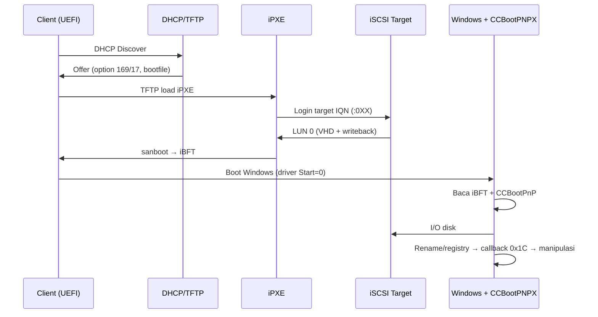

# Panduan Kompatibilitas Driver CCBoot (`CCBootPNPX.sys`) di Simple-Iscsi

> **Status:** teruji boot (lihat bukti di §7), commit `9bcd588`.
> **Prinsip:** memakai driver CCBoot asli (`CCBootPNPX.sys`) tanpa helper buatan kita dan tanpa control-plane CCBoot.
> **Ruang lingkup:** client Windows UEFI/Legacy yang boot dari iSCSI target Simple-Iscsi.

---

## 1. Dua Opsi Boot Client

Simple-Iscsi sekarang punya dua jalur kompatibilitas:

| Aspek | **Driverless (native)** | **CCBoot Driver** |
|---|---|---|
| Driver di client | Tidak ada driver pihak ketiga | `CCBootPNPX.sys` (asli CCBoot) |
| Sumber identitas | Registry native + iBFT | iBFT + `HKLM\SYSTEM\CCBootPnP` |
| IQN suffix `:0XX` | Tidak wajib | **Wajib** (divalidasi driver) |
| Manipulasi registry | Dilakukan helper/native | Dilakukan driver (delete/create/copy) |
| Kompleksitas | Sedang | Sedang-tinggi (provisioning + gate) |
| Cocok untuk | instalasi bersih, tanpa CCBoot | image yang sudah CCBoot / ingin parity |

Panduan driverless ada di `DOCUMENTATION.md` BAB 9. Dokumen ini fokus pada **opsi CCBoot driver**.

---

## 2. Cara Kerja Driver (Ringkas, Berbasis Reverse Engineering)

Driver `CCBootPNPX.sys` (versi 2.0.0.12) adalah **boot-start driver**:

1. Service dimuat kernel (`Start=0`, `Type=1`).
2. `DriverEntry 0x1400227A0` membuat `\Device\iSCSIBoot`, menyalin `RTL_OSVERSIONINFOW` ke `DeviceExtension+0xDC8`, lalu memanggil init `0x1400B5380`.
3. Init membaca **tabel ACPI iBFT** lewat `FUN_140001DF0` (konstanta `ACPI` = `0x41435049`, `iBFT` = `0x54464269`).
4. Driver membaca profil/gate dari `HKLM\SYSTEM\CCBootPnP`.
5. Driver mendaftarkan registry callback `FUN_1400AF640` (hanya bereaksi pada `RegNtPreRenameKey` = `0x1C`, dari kernel-mode).
6. Saat menerima notifikasi rename, driver **tidak me-rename**; ia melakukan **delete + create/copy + set value** pada key identitas (`FUN_14005F030`, `FUN_14005A5C0`, `FUN_140060A10`, dll.).

### 2.1 Gate IQN yang wajib

Driver memeriksa 4 karakter terakhir target IQN:

```c
s[len-4] == ':'   // 0x3A
s[len-3] == '0'   // 0x30
```

Lokasi: `0x140014131` / `0x140014228` (`FUN_1400130D0`), `0x1400072E0` / `0x140007441` dan `0x140007CEE` / `0x140007E33` (`FUN_140004520`), `0x1400329C1` / `0x140032ACF` (`FUN_140031740`).

Artinya bentuk wajib: **`:0XX` (4 karakter)**, bukan `:0` saja.

| IQN | Hasil |
|---|---|
| `...:win-milannn` | gagal |
| `...:win-milannn:0` | gagal |
| `...:win-milannn:0A` | gagal |
| `...:win-milannn:0AB` | lolos |
| `...:win-milannn:0AB:x` | gagal |

---

## 3. Syarat Wajib Agar Kompatibel

### 3.1 IQN

- Format: `<target_iqn_prefix><nama_image>:0XX`.
- Contoh: `iqn.2026-01.com.example:win-milannn:02A`.
- **Option 169 (DHCP)** dan **option 17 (root-path)** harus membawa IQN yang sama (bersuffix).
- Server **wajib memotong** suffix sebelum lookup image (`strip_ccboot_suffix` di `src/session/mod.rs`).
- Suffix dibuat otomatis oleh `with_ccboot_suffix()` di `src/netboot/dhcp.rs`; jangan menulis suffix manual (bisa dobel).

### 3.2 iBFT

- iBFT dibuat oleh **iPXE `sanboot`** atau firmware UEFI iSCSI; driver tidak membuatnya.
- Isi yang harus benar: NIC (PCI BDF/MAC), target IP, target IQN (bersuffix), LUN boot (0).
- Tanpa iBFT, driver tetap load tetapi tidak tahu target/NIC.

### 3.3 Hostname

- Sumber: DHCP option 12 / `net0/hostname` → field hostname iBFT.
- Driver menyalin ke `ComputerName`, `NV Hostname`, dan `Hostname` (`FUN_14000ECC0`).
- **Tidak ada validasi format khusus** di driver (tidak ada cek `(`, `)`, `-`). Cukup hostname valid: maks 15 karakter, alfanumerik + `-`.
- Jangan mengarang format `<Hostname>(<Number>-<Hostname>-0)`; itu tidak didukung bukti binary.

### 3.4 DHCP & TFTP

- Section `[dhcp]` **wajib ada** di `config.toml`; tanpa itu DHCP/TFTP menolak start.
- `next_server` = IP server iSCSI.
- `tftp_dir` = `pxe`.
- Bootfile PXE harus **file**, bukan folder. Contoh: `sb-custom\ipxe.efi` (UEFI).
- File shim (`revocations_sku.efi`, `shim_certificate_0.efi`) yang tidak ada biasanya **non-fatal**.

### 3.5 Image / VHD

- VHD harus **bootable** dan sesuai mode firmware:
  - UEFI → GPT + EFI System Partition.
  - Legacy → MBR + boot sector.
- Footer VHD harus `conectix` (fixed/dynamic sama-sama didukung server).
- Gunakan **writeback overlay** agar master VHD tidak berubah.
- VHD harus **offline** saat provisioning.

### 3.6 Provisioning Driver (Tanpa Helper)

- Copy `CCBootPNPX.sys` ke `\Windows\System32\drivers\`.
- Buat service key di hive SYSTEM:

```text
[HKLM\SYSTEM\ControlSet00N\Services\CCBootPNPX]
Type         = 1
Start        = 0
ErrorControl = 1
ImagePath    = \SystemRoot\System32\drivers\CCBootPNPX.sys
Group        = Boot Bus Extender
```

- **Jangan** install `CCBootClient.exe`/`CCBootPnP.exe` (control-plane) untuk mode minimal.
- **Jangan** import `CCBootPnP_config.reg`; biarkan driver/komponen CCBoot mengisi.
- Script: `scripts/provision-ccbootpnpx.ps1`.

### 3.7 Gate `CCBootPnP`

| Value | Fungsi |
|---|---|
| `PCIDPNP` | mengaktifkan jalur PnP/PCI |
| `HookPCINic` | hook NIC |
| `HookPciNodes` | hook node PCI |
| `FindPCI` | pencarian PCI |
| `HookRegNic` | ditulis driver saat rename |

Jika gate ini tidak ada/0, driver bisa tetap load tetapi manipulasi registry tidak berjalan.

### 3.8 Pemicu Manipulasi Registry

- Driver **tidak** memanggil `ZwRenameKey`.
- Urutan: komponen lain (kernel-mode) me-rename key → callback `0x1C` → driver delete/create/copy/set value.
- Rename dari **user-mode diabaikan** (`ExGetPreviousMode`), jadi jangan berharap `reg.exe` memicu driver.

### 3.9 OS, Versi, Signature

- Jalur rename aktif pada Windows modern (major ≥ 6, dan bukan Vista/Win7 early).
- Gunakan driver asli bertanda tangan; driver modifikasi bisa ditolak DSE.
- Versi driver yang dianalisis: **2.0.0.12**. Aplikasi client 3.0 tidak memengaruhi parsing iBFT.

---

## 4. Alur Boot



---

## 5. Contoh Konfigurasi

```toml
[server]
address = "0.0.0.0"
port = 3260

[dhcp]
enabled = true
start_ip = "192.168.180.100"
end_ip = "192.168.180.200"
subnet_mask = "255.255.255.0"
router = "192.168.180.1"
dns = "1.1.1.1"
next_server = "192.168.180.1"
tftp_dir = "pxe"
pxe_default = "sb-custom\\ipxe.efi"
auto_add_client = true

[windows]
target_iqn_prefix = "iqn.2026-01.com.example:win-"
vhd_dir = 'C:\vhd'
block_size = 512

[image_manager]
milannn = 'I:\VHD\image-windows.vhd'
```

```toml
# clients.toml
[[client]]
mac = "00:0C:29:9B:72:2A"
ip = "192.168.180.250"
hostname = "milanrsma"
next_server = "192.168.180.1"
image_manager = "milannn"
```

Hasil IQN: `iqn.2026-01.com.example:win-milannn:0XX`.

---

## 6. Troubleshooting

| Gejala | Penyebab | Solusi |
|---|---|---|
| `unrecognized option` | `echo ----------` di iPXE (dianggap option) | hapus baris `echo --...` |
| `start_image() invalid parameter` | `sanboot` tidak jalan / image tidak valid | pastikan script sampai `sanboot`; cek mode UEFI/GPT |
| `failed to find fs : unsupported` | SAN device kosong / disk tidak terbaca | cek login & LUN; jangan boot sebelum `sanboot` sukses |
| DHCP/TFTP tidak start | `[dhcp]` tidak ada | tambah section `[dhcp]` |
| Login sukses tapi VHD gagal | `image_manager` tidak cocok | samakan key `image_manager` client vs config |
| Rename tidak terjadi | IQN tanpa `:0XX`, gate off, atau rename user-mode | cek IQN, `CCBootPnP`, dan mode pemanggil |
| BSOD `0x7B` | storage/boot mismatch | cek driver storage, mode firmware, image |
| BSOD `0xC0000225` | BCD/image tidak ditemukan | cek EFI partition/BCD |

---

## 7. Verifikasi / Acceptance

**Di server (log):**

```text
TargetName = iqn.2026-01.com.example:win-milannn:02A
Transisi login sukses. Client masuk ke FFP
Membuka storage backend VHD: ...
Membuat cache writeback untuk LUN 0 (milannn_lun0)
```

**Di Windows client:**

```powershell
sc query CCBootPNPX
reg query HKLM\SYSTEM\CCBootPnP
reg query "HKLM\SYSTEM\CurrentControlSet\Enum\PCI" /s | findstr /i "VEN_"
```

Acceptance:
1. Service `CCBootPNPX` RUNNING.
2. `CCBootPnP` terisi (`CCBootServerIP`, `PciIdOrg`, `InstanceIdOrg`, dll.).
3. Instance ID PCI **sama** setelah reboot kedua.
4. Tidak ada BSOD/freeze.

---

## 8. Batasan & Hal yang Belum Pasti

- Arti dua karakter `XX` **belum terbukti**; dugaan: nomor client/slot. Driver hanya memvalidasi `:0`.
- Nilai `Group`/`Start` persis dari installer CCBoot belum diverifikasi; nilai di atas konservatif.
- Hubungan kausal “suffix → rename” adalah **indikasi kuat** dari uji runtime, bukan bukti penuh dari statis.
- `ccachex.sys` belum dianalisis; mungkin memakai `XX` untuk cache/client id.
- Analisis statis tidak menjalankan driver; perilaku runtime tetap perlu uji.

---

## 9. Driverless vs CCBoot: Kapan Pilih Apa?

| Kondisi | Rekomendasi |
|---|---|
| Image bersih, tanpa CCBoot | **Driverless** |
| Image sudah CCBoot / ingin parity | **CCBoot driver** |
| Ingin tanpa driver pihak ketiga | **Driverless** |
| Butuh manipulasi identitas ala CCBoot | **CCBoot driver** |
| Tidak mau provisioning VHD | **Driverless** |

---

## 10. Rollback & Keamanan

- Backup VHD sebelum provisioning.
- Hapus `CCBootPNPX.sys` + service key untuk rollback.
- Jangan menjalankan provisioning saat VHD dipakai client.
- Jangan memodifikasi `Enum\PCI` manual.

---

## 11. Referensi

- Commit: `9bcd588` (`v1.0.0-final`).
- `docs/ccbootpnpx-ibft-verification.md` — bukti iBFT/suffix.
- `docs/ccbootpnpx-vhd-provisioning.md` — langkah provisioning.
- `scripts/provision-ccbootpnpx.ps1` — script provisioning.
- `src/netboot/dhcp.rs` — suffix + hostname.
- `src/session/mod.rs` — strip suffix.
- `pxe/sb-custom/autoexec.ipxe` — script boot.

