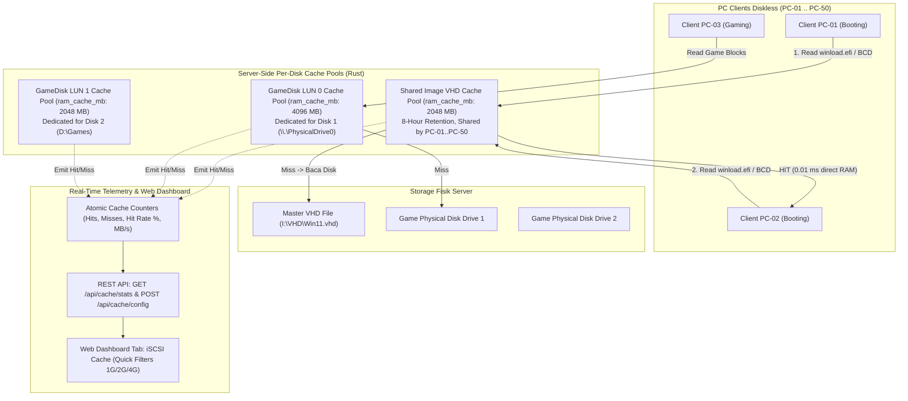

# Implementation Plan: Per-Disk Server RAM Cache & Real-Time Cache Monitor (CCBoot Parity)

- **Date:** 2026-10-21
- **Feature:** Per-Disk Server RAM Cache (MB/GB Presets), Shared Multi-Client Base Image Caching, and Real-Time iSCSI Cache Monitor Tab.
- **Goal:** Enable granular per-disk RAM cache allocation (e.g. Disk 1 = 1 GB, Disk 2 = 2 GB, Image VHD = 2 GB) with shared caching across clients, extended 8-hour idle retention, atomic telemetry metrics (Hit Rate %, MB/s), and a dedicated "iSCSI Cache" tab in the Web Dashboard.

---

## Arsitektur & Aliran Data Sistem



---

## Task 1: Konfigurasi Per-Disk RAM Cache di `config.rs` & `config.toml`

**Files:**
- Modify: `src/config.rs`
- Modify: `config.toml`
- Test: `src/config.rs` (Unit Tests)

**Interfaces:**
- `GamediskConfig`: Menambahkan field `pub ram_cache_mb: Option<u64>` (default 1024 MB jika tidak dispesifikasikan).
- `WindowsConfig`: Menambahkan field `pub ram_cache_mb: Option<u64>` (default 2048 MB).
- Helper function `parse_human_cache_size(val: &str) -> u64` untuk menerjemahkan input user ramah seperti `"512M"`, `"1G"`, `"2G"`, `"4G"`, `"8G"`, `"16G"`, `"1024"` menjadi ukuran MB murni.

- [ ] **Step 1: Tulis unit test untuk verifikasi parsing human cache size dan per-disk ram_cache_mb**
  - Menguji input `"1G"` $	o 1024$, `"2G"` $	o 2048$, `"512M"` $	o 512$, dan bilangan integer polos `2048` $	o 2048$.
- [ ] **Step 2: Jalankan test dan pastikan gagal sebelum implementasi**
  - Command: `cargo test test_parse_human_cache_size`
- [ ] **Step 3: Implementasikan field dan parser di `src/config.rs`**
  - Tambahkan helper dan deserialize serde custom untuk `ram_cache_mb`.
- [ ] **Step 4: Jalankan test kembali dan pastikan lulus**
  - Command: `cargo test test_parse_human_cache_size`
- [ ] **Step 5: Perbarui contoh `config.toml`**

---

## Task 2: Modifikasi `ReadAheadCache` (Per-Disk Capacity, 8-Hour TTI, & Atomic Telemetry)

**Files:**
- Modify: `src/read_ahead.rs`
- Test: `src/read_ahead.rs` (Unit Tests)

**Interfaces:**
- `ReadAheadCache`:
  - `pub fn new_mb(ram_cache_mb: u64, chunk_size_bytes: u64) -> Option<Self>`
  - `time_to_idle` diubah dari 300 detik menjadi 28.800 detik (8 jam).
  - Field atomic counters:
    - `hit_count: Arc<AtomicU64>`
    - `miss_count: Arc<AtomicU64>`
    - `cached_read_bytes: Arc<AtomicU64>`
    - `direct_read_bytes: Arc<AtomicU64>`
  - Method telemetri:
    - `pub fn stats(&self) -> CacheStatsSnapshot`
    - `pub fn clear(&self)`

- [ ] **Step 1: Tulis unit test untuk verifikasi alokasi MB, hit/miss counter, dan hit rate %**
  - Menguji hit counter bertambah saat `cache.get()` berhasil, dan miss counter bertambah saat miss.
- [ ] **Step 2: Jalankan test verifikasi kegagalan**
  - Command: `cargo test test_read_ahead_telemetry`
- [ ] **Step 3: Implementasikan struktur telemetri dan inisialisasi MB di `src/read_ahead.rs`**
- [ ] **Step 4: Jalankan test kembali dan pastikan PASS**
  - Command: `cargo test test_read_ahead_telemetry`

---

## Task 3: Shared Base Image Caching pada Multi-Client VHD (`writeback_imagedisk.rs` & `backend.rs`)

**Files:**
- Modify: `src/backend.rs`
- Modify: `src/writeback_imagedisk.rs`
- Modify: `src/main.rs`
- Test: `src/writeback_imagedisk.rs`

**Interfaces:**
- `Backend`:
  - Mengubah `read_cache: Option<ReadAheadCache>` menjadi `read_cache: Option<Arc<ReadAheadCache>>`.
  - Menambahkan konstruktor `new_vhd_diff_with_shared_cache(..., shared_cache: Option<Arc<ReadAheadCache>>)`.
- `writeback_imagedisk.rs`:
  - Menambahkan registry global `static IMAGE_CACHE_REGISTRY: Lazy<DashMap<String, Arc<ReadAheadCache>>>`.
  - Saat client boot, lookup registry berdasarkan canonical VHD path. Jika belum ada, alokasikan `ReadAheadCache` baru sesuai `ram_cache_mb` konfigurasi image dan simpan di registry.
  - Setiap differencing disk child menghubungkan bacaan parent ke shared cache ini.

- [ ] **Step 1: Tulis unit test multi-client shared cache**
  - Client 1 membaca sektor LBA 0-10, Client 2 membaca LBA 0-10 yang sama $	o$ verifikasi Client 2 mencatat 100% Cache Hit tanpa disk I/O.
- [ ] **Step 2: Jalankan test verifikasi kegagalan**
  - Command: `cargo test test_shared_vhd_cache_multi_client`
- [ ] **Step 3: Implementasikan `IMAGE_CACHE_REGISTRY` dan injeksi shared cache ke backend child VHD**
- [ ] **Step 4: Perbarui inisialisasi Gamedisk di `src/main.rs` agar membaca `gd_cfg.ram_cache_mb` per disk**
- [ ] **Step 5: Jalankan test dan pastikan PASS**
  - Command: `cargo test test_shared_vhd_cache_multi_client`

---

## Task 4: REST API Telemetri Cache & Dynamic Tuning (`server_api.rs`)

**Files:**
- Modify: `src/server_api.rs`
- Modify: `src/service_manager.rs`

**Interfaces:**
- `GET /api/cache/stats`: Mengembalikan JSON snapshot per-disk:
  ```json
  [
    {
      "disk_id": "lun0",
      "name": "GameDisk-0",
      "type": "gamedisk",
      "ram_cache_mb": 4096,
      "used_cache_mb": 1842,
      "hit_count": 14250,
      "miss_count": 680,
      "hit_rate_pct": 95.4,
      "cached_read_mbps": 482.5
    },
    {
      "disk_id": "img_win11",
      "name": "Win11_Pro.vhd",
      "type": "imagedisk",
      "ram_cache_mb": 2048,
      "used_cache_mb": 1120,
      "hit_count": 89200,
      "miss_count": 140,
      "hit_rate_pct": 99.8,
      "cached_read_mbps": 820.1
    }
  ]
  ```
- `POST /api/cache/config`: Memperbarui `ram_cache_mb` secara live tanpa restart service.
- `POST /api/cache/clear`: Membersihkan cache disk tertentu secara manual.

- [ ] **Step 1: Tambahkan handler endpoint `/api/cache/stats`, `/api/cache/config`, dan `/api/cache/clear`**
- [ ] **Step 2: Verifikasi respons HTTP API menggunakan curl / python script**

---

## Task 5: Desain & Integrasi Tab Baru "iSCSI Cache" di Web Dashboard (`ui/index.html`)

**Files:**
- Modify: `ui/index.html`

**Komponen UI:**
1. **Sidebar Navigation:**
   - Tambahkan item menu tab baru: `iSCSI Cache` (Icon CPU/Memory).
2. **Stat Cards Ringkasan:**
   - Total Server RAM Cache Allocated (MB/GB).
   - Global Cache Hit Rate (`%` dengan progress ring).
   - Real-time Read Speed from Cache (MB/s).
3. **Quick Preset Filter Buttons:**
   - Tombol selektor cepat: `512 MB`, `1 GB`, `2 GB`, `4 GB`, `8 GB`, `16 GB` (sehingga user awam tidak perlu menghitung `1024 * X`).
4. **Tabel Monitor Per-Disk:**
   - Kolom: Disk / Target Name, Tipe (Game / OS Image), Alokasi RAM (MB/GB), Penggunaan Saat Ini, Hits, Misses, Hit Rate (Progress Bar Warna Hijau/Kuning), Tombol "Ubah Ukuran" & Tombol "Flush Cache".

- [ ] **Step 1: Tambahkan nav link dan section `#tab-cache` di `ui/index.html`**
- [ ] **Step 2: Implementasikan script polling real-time `/api/cache/stats` (refresh tiap 2 detik)**
- [ ] **Step 3: Tambahkan modal dialog / quick preset buttons untuk mengubah ukuran cache per disk**
- [ ] **Step 4: Uji visualisasi di browser**

---

## Task 6: Verifikasi End-to-End, Dokumentasi, & Git Commit

**Files:**
- Modify: `DOCUMENTATION.md`
- Compile & Run: `cargo test` & `cargo build --release`

- [ ] **Step 1: Jalankan kompilasi proyek secara utuh**
  - Command: `cargo check && cargo build --release`
- [ ] **Step 2: Jalankan seluruh test suite**
  - Command: `cargo test`
- [ ] **Step 3: Dokumentasikan fitur Per-Disk Server Cache & Quick Presets di `DOCUMENTATION.md` (Subbab 6.5)**
- [ ] **Step 4: Commit dan push perubahan**
